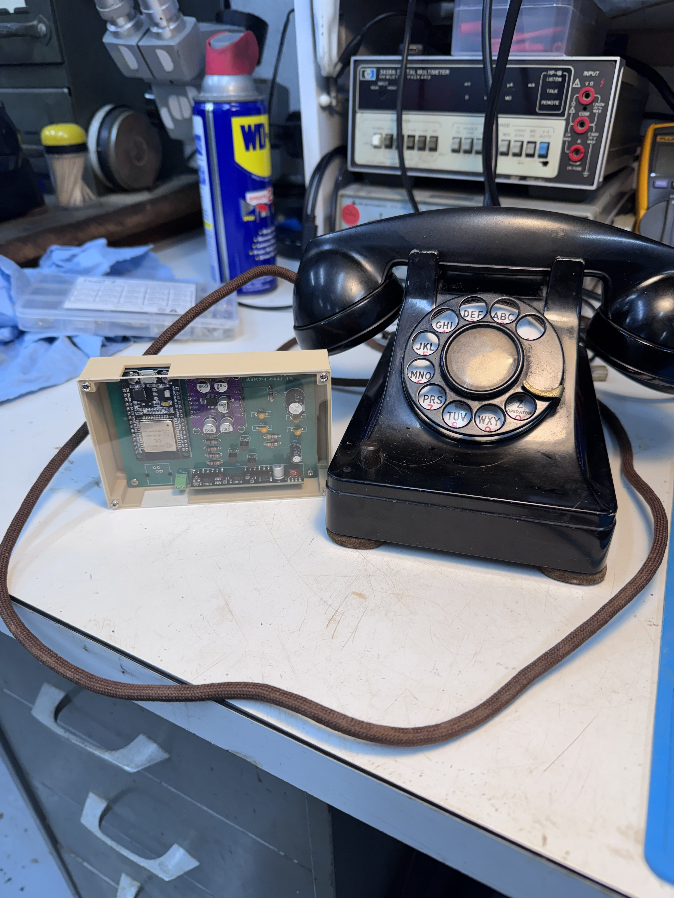
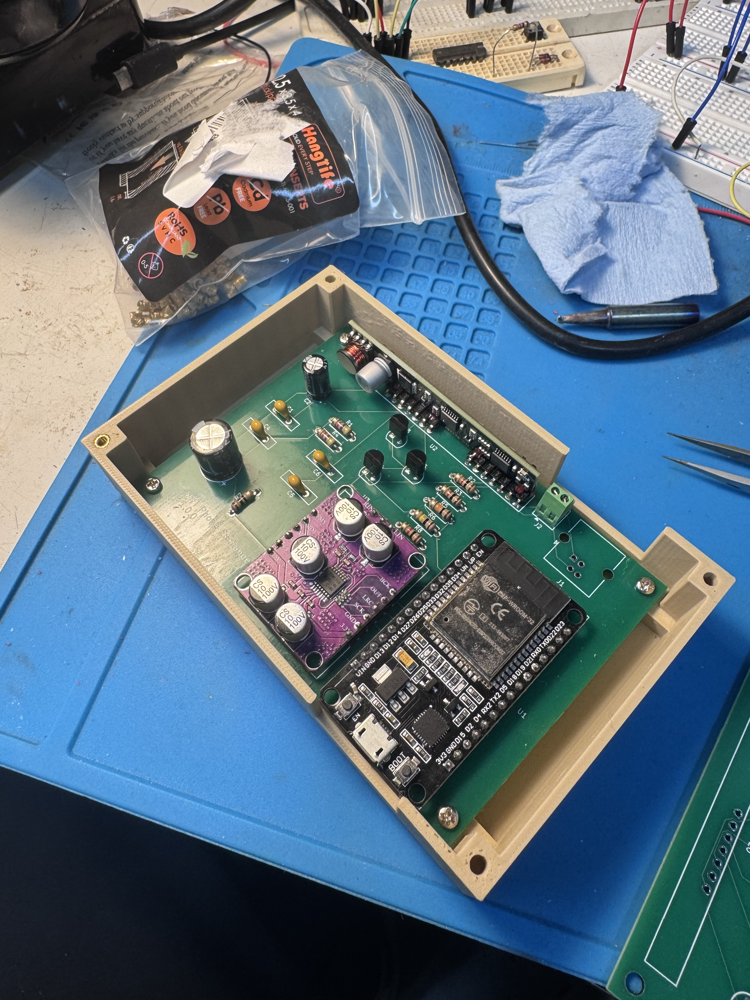

# ESP32 Rotary Exchange

A small private telephone exchange for vintage rotary phones. Each phone
plugs into its own board: an ESP32, a Silvertel AG1170 subscriber-line
circuit, and a PCM1808 analog-to-digital converter. The nodes find each
other over Wi-Fi and place three-digit calls. A computer can join the same
network as a softphone.

<p>
  
  
</p>

```text
  rotary phone 456                         rotary phone 123
        |                                        |
   ESP32 + AG1170                           ESP32 + AG1170
        \                                      /
         \------------ Wi-Fi / UDP -----------/
                          |
                    PC softphone 111
```

Lifting the handset produces a North American dial tone (350 Hz + 440 Hz).
Dialing `4`, `5`, `6` calls the node that announced itself as 456. The
caller hears ringback (440 Hz + 480 Hz) while the far phone rings. When
that handset is picked up, both ends switch to 8 kHz audio. Hanging up
either phone ends the call.

This is a private exchange. The RJ11 jack is for one telephone on this
board. Do not connect it to the public telephone network. The AG1170
produces telephone ring voltage, which is high enough to hurt.

## Repository

```text
firmware/esp32_rotary_exchange/   ESP32 sketch
software/softphone/               PC softphone
hardware/esp32-phone-exchange/    KiCad schematic, PCB, gerbers, 3D model
docs/hardware.md                  Wiring, power, and bill of materials
docs/protocol.md                  UDP packet format and call sequence
docs/images/                      Photos of a finished module
```

The KiCad project keeps the name `esp32-phone-exchange`. That name is
stored throughout the schematic, the board, and the gerber filenames.

## Firmware

The sketch needs an original ESP32 module (ESP-WROOM-32) and
Arduino-ESP32 **2.0.x**. It uses the legacy I2S driver so receive audio
and the call tones can play through the built-in DAC on GPIO25.
ESP32-C3, S2, and S3 modules do not have that DAC.

1. Install the Arduino IDE and, in Boards Manager, install **esp32 by
   Espressif Systems** at a 2.0.x release. Do not use 3.x.
2. Open `firmware/esp32_rotary_exchange/esp32_rotary_exchange.ino`.
   The folder name and the sketch name have to match.
3. Edit `config.h` in that same folder. Set the Wi-Fi name, the
   password, and a unique three-digit `NODE_NUMBER`.
4. Under **Tools > Board**, choose **ESP32 Dev Module** and upload.

Give every board a different number. Leave **111** unused if you want the
softphone at its default extension.

GPIO1 is the PCM1808 master clock and the serial TX pin. The monitor
shows the banner, the Wi-Fi address, and the first discovery hello.
The codec clock then takes the pin, and later lines (including
`PEER DISCOVERED`) do not appear. Use `l` on the softphone to see
whether the board is on the network.

If phones on the same LAN never see each other, the router is probably
dropping broadcast to `255.255.255.255`. Set `DISCOVERY_IP` in the sketch
and `DISCOVERY_ADDR` in the softphone to the subnet broadcast, such as
`192.168.1.255`.

## Softphone

The computer is another phone. It does not answer by itself. The
microphone and speaker are the handset.

```bash
python3 -m pip install -r software/softphone/requirements.txt
python3 software/softphone/softphone.py
```

Useful invocations:

```bash
python3 software/softphone/softphone.py --number 222
python3 software/softphone/softphone.py --bind 192.168.1.50
python3 software/softphone/softphone.py --tx-gain 8 --list-devices
```

Commands once it is running:

| Command | Action |
| --- | --- |
| `c 456` | Call extension 456 |
| `a` | Answer an incoming call |
| `h` | Hang up |
| `t` | Toggle a 1 kHz test tone in place of the microphone |
| `g 8` | Set microphone gain |
| `s` | Print audio levels and packet rates |
| `l` | List discovered phones |
| `p` | Send a discovery hello immediately |
| `q` | Quit |

The phone's DAC keeps only the top 8 bits of each sample, so a quiet
laptop microphone disappears unless the transmit gain is high. The
default gain is 8. `t` sends a loud beep and is the quickest way to
prove the path to the handset. On macOS, Terminal needs microphone
permission before the input device will open.

Audio starts only after the call is answered. An ESP32 node also sends
microphone audio only while its handset is off the hook.

## Hardware

The board is a two-layer design, about 103 mm by 70 mm and 1.6 mm thick.
Open `hardware/esp32-phone-exchange/esp32-phone-exchange.kicad_pro` in
KiCad 10. Fabrication files exported from this design are in
`hardware/esp32-phone-exchange/gerbers/`. Zip that folder when a board
house asks for an upload. `esp32-phone-exchange.stl` is a 3D
model of the board, and `esp32-phone-exchange-enclosure.stl` is a
printable case for it.

Part values, the GPIO map, the level shifters, and the AG1170 power-down
wiring are in [docs/hardware.md](docs/hardware.md). Read that before
building. The power-down pin is not a normal logic input: pulling it up
to 5 V damages the AG1170 DC/DC converter.

## Network

Every node speaks one UDP protocol on port **5000**: discovery, call
setup, and audio. There is no registration server. Each node broadcasts
a hello every 5 seconds and remembers up to five peers for 30 seconds.

The packet layout is in [docs/protocol.md](docs/protocol.md).

Audio is uncompressed on purpose:

- 8000 Hz
- 16-bit signed PCM, little-endian
- mono
- 20 ms packets (160 samples)

## First call

Bring up one board and the softphone on the same Wi-Fi network before
wiring a second telephone.

1. From the softphone, `l` should show the ESP32. The board's own
   discovery log is not visible, because the serial pin is already the
   codec clock.
2. `c 456` and let the real phone ring.
3. Pick up and confirm audio in each direction. Use `t` if the
   microphone is hard to hear.
4. Hang up from each side.
5. Dial the softphone's number, `111`, from the rotary phone and answer
   with `a`.
