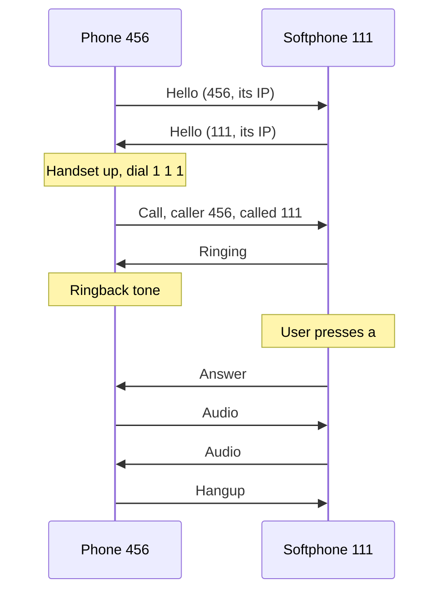

# Protocol

Every node, including the softphone, uses one UDP port for discovery,
call setup, and audio. There is no server. A node that wants to be
callable broadcasts a hello, and a node that wants to call sends a
control packet to the address it learned.

| | |
| --- | --- |
| Port | 5000 |
| Discovery address | `255.255.255.255`, or the subnet broadcast if the router drops that |
| Hello interval | 5 seconds |
| Peer timeout | 30 seconds |
| Peers remembered | 5 (oldest entry is replaced) |
| Byte order | Little-endian |

The ESP32 sketch and `software/softphone/softphone.py` are the two
implementations. The field layouts below are what both of them pack.

## Common header

Every datagram starts with this 12-byte header.

| Offset | Type | Field | Meaning |
| --- | --- | --- | --- |
| 0 | uint32 | magic | `0x544C5032` |
| 4 | uint8 | type | Packet type |
| 5 | uint8 | version | `2` |
| 6 | uint16 | sequence | Audio frame counter. Zero on hello and control. |
| 8 | uint16 | samples | Number of audio samples. Zero except on audio. |
| 10 | uint16 | reserved | Zero |

The magic number is the characters `TLP2` stored as a little-endian
word. The first four bytes on the wire are `0x32 0x50 0x4C 0x54`.
Packets with a different magic or version are ignored.

| type | Name |
| --- | --- |
| 1 | Hello |
| 2 | Audio |
| 3 | Control |

## Hello

20 bytes: the header, then the sender's identity.

| Offset | Type | Field |
| --- | --- | --- |
| 12 | uint16 | Phone number, 0–999 |
| 14 | uint8[4] | IPv4 address, one octet per byte |
| 18 | uint8[2] | Reserved, zero |

A node ignores its own number. If the address field is `0.0.0.0`, the
receiver uses the UDP source address instead. The softphone and the
ESP32 both put their LAN address in the field and also broadcast the
datagram, so a peer can answer to a unicast address.

## Control

20 bytes: the header, then the call message.

| Offset | Type | Field |
| --- | --- | --- |
| 12 | uint8 | Code |
| 13 | uint8 | Value, unused, zero |
| 14 | uint16 | Caller number |
| 16 | uint16 | Called number |
| 18 | uint16 | Reserved, zero |

| Code | Name | When it is sent |
| --- | --- | --- |
| 1 | Call | Caller has finished dialing and the callee is in the peer table. |
| 2 | Ringing | Callee is on-hook, idle, and is ringing the phone. |
| 3 | Answer | Callee went off-hook, or the softphone user pressed `a`. |
| 4 | Hangup | Either side cleared the call. |
| 5 | Busy | Callee is already off-hook or in another call. |
| 6 | Reject | Defined and handled like busy. The current firmware does not send it. |
| 7 | Ping | Defined. Neither side sends it, and a received ping is ignored. |

`Call` is addressed to one node. A callee ignores a call whose called
number is not its own. If it cannot take the call it replies `Busy` to
the sender.

## Audio

The header is followed by `samples` little-endian signed 16-bit
samples. `samples` is at most 160, and the payload has to be at least
`samples * 2` bytes. One full frame is 160 samples, which is 20 ms at
8 kHz, so a connected call is 50 packets per second in each direction.

The sequence number increments by one for each audio datagram that was
actually queued. A gap means a lost frame. The ESP32 plays whatever has
arrived and fills the rest of a DAC period with silence. The softphone
waits until about 80 ms of audio is buffered, then plays it, and counts
underruns when the buffer runs dry.

Audio is sent only while the call is connected. An ESP32 node also
refuses to send microphone audio unless its handset is off-hook. The
PCM1808 sample is 24 bits, left-justified in a 32-bit I2S word; the
firmware keeps the top 16 bits. In the other direction the ESP32 DAC is
8-bit, so only the top 8 bits of a received sample are audible in the
handset.

There is no codec and no jitter buffer beyond that short softphone
prime.

## Placing a call

Extensions in this diagram are examples. 456 is an ESP32 with a rotary
phone. 111 is the softphone.

From the caller's point of view:

1. Off-hook, with no call in progress, starts dial tone and arms the
   rotary decoder. The ESP32 will not treat the pickup itself as a
   pulse.
2. Each digit is a train of hook pulses. Ten pulses is digit 0. A new
   digit is recognized after about 300 ms of silence on the dial. If
   three digits are not finished within 3 seconds of the last digit,
   the node returns to dial tone.
3. On the third digit the node looks up the number. No peer means busy
   tone, and nothing is sent. A peer means ringback, and a `Call`
   packet goes to that IP.
4. `Ringing` keeps the ringback tone. `Answer` stops it and starts
   audio. `Busy` or `Reject` plays busy tone and clears the remote
   address.
5. On-hook, or a `Hangup` from the other end, ends the call. After a
   remote hangup, an ESP32 whose handset is still up returns to dial
   tone.

An incoming `Call` rings the phone only when this node is idle and
on-hook. Ringing a phone that is already at someone's ear would put
ring voltage on the handset, so an off-hook idle phone returns `Busy`.
Picking up the ringing phone sends `Answer`. The physical ringer runs
2 seconds on and 4 seconds off, and during the on time the firmware
flips `F/R` every 25 ms to make the ring cadence.

Tones are generated locally on the ESP32 DAC. They are not network
audio.

| Tone | Frequencies | Cadence |
| --- | --- | --- |
| Dial | 350 Hz + 440 Hz | Steady |
| Ringback | 440 Hz + 480 Hz | 2 s on, 4 s off |
| Busy | 480 Hz | 0.5 s on, 0.5 s off |
